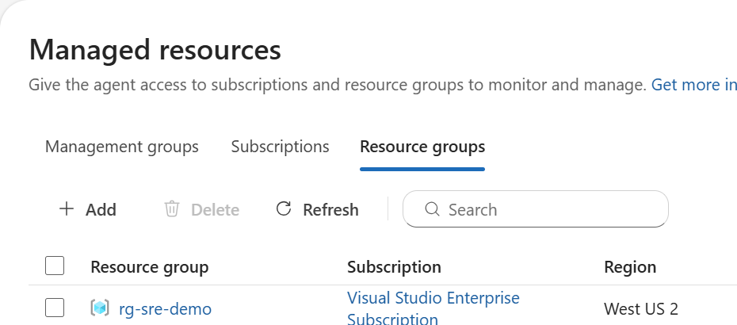
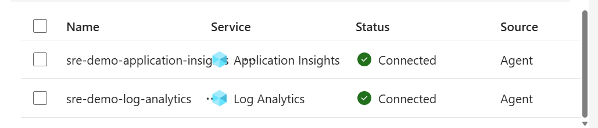
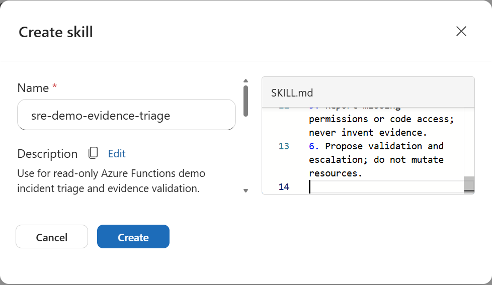

## Outcome and boundaries

Connect your application context before asking Azure SRE Agent to diagnose it.
Then add reusable procedures as skills and validate their behavior with actual
read-only tool results.

This walkthrough uses the public evaluation workload, not a production service.
Screenshots were captured from the native Agent interface on October 14, 2026.
They are cropped to configuration content rather than credentials or account
details. UI labels can differ between the preview navigation and the
documentation's older **Builder** navigation.

> [!IMPORTANT]
> The portal and GitHub guide do not configure your Agent automatically.
> Resource permissions, source connections, knowledge indexing, skill creation,
> skill enablement, and successful execution are separate checks.

The [technical paper](https://sredemo-be3wpifmuf.azurewebsites.net/api/sre-deep-dive#setup)
provides the architecture and a timestamped setup record.

## Contents

* [Prepare access and governance](#prepare-access-and-governance)
* [Register workload resources](#register-workload-resources)
* [Connect GitHub source code](#connect-github-source-code)
* [Connect workload telemetry](#connect-workload-telemetry)
* [Upload and validate knowledge](#upload-and-validate-knowledge)
* [Understand skills and skill sets](#understand-skills-and-skill-sets)
* [Create a custom skill](#create-a-custom-skill)
* [Attach tools and enable skills](#attach-tools-and-enable-skills)
* [Validate an investigation](#validate-an-investigation)
* [Troubleshoot setup](#troubleshoot-setup)
* [Operate and maintain the configuration](#operate-and-maintain-the-configuration)
* [Microsoft Learn references](#microsoft-learn-references)

## Prepare access and governance

1. Sign in to [Azure SRE Agent](https://sre.azure.com/) with the intended tenant.
2. Open the existing Agent, or follow Microsoft's
   [creation and setup workflow](https://learn.microsoft.com/en-us/azure/sre-agent/create-and-set-up)
   to create one in a supported region. Confirm subscription, resource group,
   managed identity, billing, and cleanup ownership before creating resources.
3. Confirm that your Agent user role permits configuration. The human's Agent
   role is distinct from the operational managed identity's Azure RBAC access.
4. Keep the Agent in **Review** mode for this walkthrough. Do not enable
   autonomous remediation or grant Contributor to complete an onboarding bar.
5. Agree on allowed resource scope, query window, telemetry retention, budget,
   escalation contact, and teardown deadline.

Review mode is not a universal guarantee that every side effect requires
approval. Effective authorization also depends on resource RBAC, tools,
tool-access policies, hooks, and automation configuration. See
[run modes](https://learn.microsoft.com/en-us/azure/sre-agent/run-modes) and
[permissions](https://learn.microsoft.com/en-us/azure/sre-agent/permissions).

### Demo resource map

| Purpose              | Demo value                            |
|----------------------|---------------------------------------|
| Agent                | `msdn-sre-agent`                       |
| Agent resource group | `rg-sre-agent`                         |
| Workload group       | `rg-sre-demo`                          |
| Operational identity | `msdn-sre-agent-aaxceouyeq3aw`          |
| Function App         | `sredemo-be3wpifmuf`                   |
| Application Insights | `appi-sredemo-be3wpifmuf`              |
| Log Analytics        | `log-sredemo-be3wpifmuf`               |
| Repository           | `azure-sre-agent-demo`, branch `main`  |

Replace these names for your environment. Never copy a demo subscription or
workspace ID into a production configuration without checking the target.

## Register workload resources

In the current UI, open **Build + setup > Context > Managed resources**.
On a narrow window, expand the navigation menu first. The onboarding card
**Azure resources > Add more** reaches the same setup workflow.

1. Select **Resource groups**, then **Add**.
2. Select the subscription and `rg-sre-demo`.
3. Select **Reader**, not Privileged.
4. Review the proposed role assignments and scope.
5. Save, refresh, and confirm that the group appears in Managed resources.
6. Independently verify the operational managed identity's assignments.



*Figure 1. The saved workload scope. The list confirms registration, not
successful telemetry access or a grant of write permissions.*

The native Reader workflow used these roles on the demo group:

* Reader
* Monitoring Reader
* Log Analytics Reader
* Workbook Reader
* Storage Blob Data Reader

Storage Blob Data Reader permits reading blob contents within its effective
scope. Review that data exposure before applying the same group-level role in
a production subscription. Use a group containing only approved workload data.

### Check or apply read access with PowerShell

Use [Configure-AgentContext.ps1](../scripts/Configure-AgentContext.ps1) from the
repository root with PowerShell 7 and an authenticated Azure CLI:

```powershell
# Inspect only; substitute your subscription GUID.
.\scripts\Configure-AgentContext.ps1 -SubscriptionId <subscription-guid>

# Preview missing assignments.
.\scripts\Configure-AgentContext.ps1 -SubscriptionId <subscription-guid> -Apply -WhatIf

# Add only missing assignments after reviewing the preview.
.\scripts\Configure-AgentContext.ps1 -SubscriptionId <subscription-guid> -Apply
```

Apply requires role-assignment permission on the target group. The script
resolves the Agent's operational identity rather than assuming its
system-assigned identity is the one used for investigations.

Check `ReadAccessReady`, `MissingRoles`, and `AgentRunMode`. The script always
reports `NativeConnectionsVerified: false` because role assignments cannot
prove repository authorization, connector registration, indexing, or queries.
Do not rerun the full deployment script to fix context on an existing evaluation:
full infrastructure deployment recomputes its teardown deadline.

## Connect GitHub source code

Open **Build + setup > Context > Code access**, or choose **Connect
repositories** on the onboarding cards.

1. Select **GitHub > Add repository**.
2. Enter the approved repository URL. This demo uses
   [KrishnaDistributedcomputing/azure-sre-agent-demo](https://github.com/KrishnaDistributedcomputing/azure-sre-agent-demo).
3. Select the approved connection method. Prefer the native OAuth flow when
   your organization permits it.
4. Select **Sign in to GitHub**. Allow the authentication popup if blocked.
5. Review the requested domain, organization, repository, and capability scope.
   Do not approve broader access than your organization allows.
6. Finish authentication, select the repository, and add it.
7. Wait for indexing and ask the Agent to cite a specific implementation.

The native flow can display a credential scope covering multiple repositories.
Read that notice instead of assuming a single repository URL implies
single-repository credentials.

> [!WARNING]
> Never copy a GitHub CLI token into chat, screenshots, Markdown, or a public
> webpage. Complete authorization through the native consent screen. If using
> an organization-approved PAT or GitHub App instead, follow the documented
> credential storage and least-privilege process.

For validation, ask where `http-500` is implemented and request a file citation
and commit or branch context. A public repository being reachable in a browser
does not establish a native Agent repository connection. A knowledge-file
upload is not a replacement for repository indexing.

At the recorded demo checkpoint, GitHub remained unconnected because the OAuth
popup was blocked and the owner chose to defer authorization. Publishing this
guide to GitHub does not resolve that consent step.

## Connect workload telemetry

Use **Logs > Connect more** on the onboarding cards. Existing connections can
be inspected under **Build + setup > Extensions > Connectors**.
Add one provider at a time.

### Add Application Insights

1. Select **Application Insights**, then **Next**.
2. Name the connection `sre-demo-application-insights`.
3. Select the subscription, `rg-sre-demo`, and `appi-sredemo-be3wpifmuf`.
4. If the picker cannot find it, expand **Enter a resource ID**, paste the
   component's ARM ID from its Azure resource properties, and select **Resolve**.
5. Confirm the operational identity, `msdn-sre-agent-aaxceouyeq3aw`.
6. Review the resource, identity, and read permissions; select **Add connector**.

The component ARM ID ends with:

```text
/resourceGroups/rg-sre-demo/providers/Microsoft.Insights/components/appi-sredemo-be3wpifmuf
```

Prepend `/subscriptions/<subscription-guid>` to construct the full ID.
The Agent's own Application Insights diagnostic configuration is not proof
that your workload component is connected.

### Add Log Analytics

1. Start another log connection and select **Log Analytics Workspace**.
2. Name it `sre-demo-log-analytics`.
3. Select `log-sredemo-be3wpifmuf` in `rg-sre-demo`.
4. Resolve the full ARM ID if necessary.
5. Confirm the same operational identity and Log Analytics Reader access.
6. Review, save, and inspect the connector list.

The workspace ARM ID ends with:

```text
/resourceGroups/rg-sre-demo/providers/Microsoft.OperationalInsights/workspaces/log-sredemo-be3wpifmuf
```



*Figure 2. Both workload telemetry entries show Connected. This is a UI status
snapshot, not an independent execution test of each named connector.*

Use `AppTraces` and `AppRequests` for this workspace-based workload. Agent audit
events are a separate evidence source. The query path may use built-in Azure
Monitor tools rather than a connector with the display name you entered.
Record which path actually runs.

## Upload and validate knowledge

Open **Build + setup > Context > Knowledge sources**, then **Add file**.

1. Review each document for accuracy, secrets, personal information, and scope.
2. Start with the project's README and a reviewed workload runbook.
3. Upload the files and wait for **Indexed**.
4. Ask the Agent a question that requires a passage from the uploaded material.
5. Confirm the retrieved source and quoted or summarized content.
6. Replace outdated uploads when the architecture or procedure changes.

Do not upload local settings, deployment credentials, tokens, connection
strings, customer data, or invented incident history. Review scenario
documentation against the current implementation before treating it as a
source of operational truth.

Knowledge files provide searchable reference material. They do not attach
execution tools and do not automatically become skills.

## Understand skills and skill sets

Here, a *skill set* means a small collection of related native SRE Agent skills.
It is not a separate Azure resource or a bundle automatically installed by
adding a repository.

* Skills provide reusable procedures and optional attached tools. The Agent
  loads relevant skills automatically based on their descriptions.
* Custom agents provide scoped specialists, invoked explicitly with `/agent`.
  They can be configured to access selected skills.
* Knowledge files provide searchable reference content without tools.
* Connectors expose authenticated tools or data integrations. A skill can use
  permitted tools, but its instructions do not grant Azure permissions.

Native SRE Agent skills are not VS Code Copilot skills. Creating a local
`SKILL.md` or committing it to GitHub does not by itself install it in the
Azure service.

### Suggested read-only skill set

| Skill purpose             | When to use it                            | Evidence boundary                              |
|---------------------------|-------------------------------------------|------------------------------------------------|
| Demo evidence triage      | HTTP failures, latency, or telemetry gaps  | Cite actual queries and implementation         |
| Queue backlog assessment  | Enqueue spikes or queue alerts             | Producer counts are not queue depth            |
| Configuration comparison  | Demo configuration drift                   | Compare settings with approved baseline        |
| Report evidence checks    | Building reliability reports               | Label illustrative charts and missing metrics  |

Start with one procedure. Add the other skills only when they have a clear
trigger, an owner, a tested workflow, and appropriate tool access.

## Create a custom skill

Microsoft Learn calls this **Builder > Skills**. In the preview navigation
captured here, use **Build + setup > Extensions > Skill builder**.
The adjacent **Skills** page controls built-in and custom-skill enablement.

1. Open **Skill builder**, then **Create skill**.
2. Use a descriptive name such as `sre-demo-evidence-triage`.
3. Write a specific description identifying when the skill should activate.
4. Edit the default `SKILL.md`. Keep its name and description consistent with
   the form.
5. Add reviewed supporting files only if the procedure needs them.
6. Choose tools as described in the next section.
7. Review the procedure and permissions before selecting **Create**.
8. Reopen the saved entry to verify its content and tool list.



*Figure 3. An instructional skill-authoring example. No demo custom skill is
left installed by this documentation task. The complete procedure is below.*

Paste this original example into the skill editor:

````markdown
---
name: sre-demo-evidence-triage
description: Use for read-only Azure Functions demo incident triage and evidence validation.
---

# Demo evidence triage

## Scope

Investigate only the approved subscription and rg-sre-demo.
Do not change resources, settings, role assignments, or incident integrations.

## Procedure

1. Confirm subscription, workspace, resource scope, and UTC query window.
2. Query AppTraces and AppRequests. Supply subscription explicitly.
3. Record tool names, KQL, row counts, timestamps, and any tool errors.
4. Retrieve reviewed source code if connected; otherwise report code pending.
5. Separate observed behavior, hypotheses, and simulation labels.
6. Propose a validation or escalation step without performing remediation.

## Interpretation limits

HTTP 500 and payment failures are synthetic demo responses.
Queue item_count is the number produced, not current queue depth.
There is no queue consumer, poison handling, or replay workflow in this demo.
Memory allocation does not prove a leak or out-of-memory termination.
Changing the release marker does not recover deployment-regression.
Never invent telemetry, production impact, or a successful recovery.

## Output

Return scope, evidence, hypotheses, limitations, and next validation.
If access fails, include the exact error and stop unsupported conclusions.
````

The example gives procedural guidance, not a security enforcement boundary.
Use Azure RBAC and tool policies to enforce read-only access.

## Attach tools and enable skills

Select **Choose tools** in the skill form.

1. Inspect individual tool descriptions and parameters.
2. For the first evaluation, choose only authorized log-query or read-only
   resource-inspection tools required by the procedure.
3. Microsoft documents `RunAzCliReadCommands` as a read-command tool. Your
   environment might expose Azure Monitor MCP tools or other query tools
   instead. Use the actual names visible in your picker.
4. Do not select whole tool categories without checking their contents.
   Do not attach write-command, deployment, restart, or configuration tools
   to a read-only skill.
5. Save, reopen the entry, and confirm the exact attached tools.

You can also create a guidance-only skill with no tools. It cannot gain
execution capability from its prose alone; available Agent tools and
authorization still determine what can run.

Open **Extensions > Skills > Custom skills**, enable the intended skill, and
save changes if the UI requires it. Confirm the enabled state after a refresh.
Do not confuse the number of enabled skills with the number currently loaded
into a conversation.

To restrict a custom specialist, use **Agent Canvas > Choose Skills**.
Microsoft also documents `allowed_skills` in custom-agent YAML:

```yaml
name: demo_evidence_specialist
system_prompt: |
  Investigate approved demo evidence without changing resources.
allowed_skills:
  - sre-demo-evidence-triage
```

This is a configuration fragment, not a complete deployment artifact. Preserve
the schema and tool configuration exported by your Agent Canvas. Invoke a
custom agent with the documented `/agent` workflow; a skill normally loads
automatically when relevant and does not require a `/skill` command.

Microsoft currently documents at most five concurrently active skills.
Older active skills unload as needed, and compaction clears active skills.
Skill-attached tools are available while that skill is active. Recheck
[Skills](https://learn.microsoft.com/en-us/azure/sre-agent/skills) before relying
on these limits.

## Validate an investigation

Use one bounded prompt rather than repeatedly asking broad health questions.
Queries and model-assisted investigations can consume AAUs and service charges.

```text
Perform a read-only demo evidence investigation for rg-sre-demo.
Use the demo evidence triage skill if it is installed and enabled.
Subscription: <subscription-guid>.
Workspace: <workspace-guid-or-approved-name>.
Pass subscription explicitly to Azure Monitor tools.
Query AppTraces and AppRequests for the last 24 hours.
Return counts, latest UTC timestamps, KQL, workspace, and actual tool names.
Retrieve the uploaded README configuration section and cite its source.
If GitHub is not connected, state code pending.
Do not change resources or infer a diagnosis from simulation labels.
Report connector, permission, or indexing failures exactly.
```

Use this KQL:

```kusto
union withsource=SourceTable AppTraces, AppRequests
| where TimeGenerated > ago(24h)
| summarize Rows=count(), Latest=max(TimeGenerated) by SourceTable
```

### Acceptance checklist

* The resource group is registered with the approved read scope.
* The operational identity has the required scoped roles.
* The Agent remains in Review mode.
* Workload telemetry sources are saved and their intended query path works.
* A tool result, not only the Agent's prose, contains the actual query result.
* Knowledge search retrieves a relevant passage from the indexed document.
* A repository citation resolves to the intended branch and source, or code
  remains explicitly pending.
* The custom skill is saved and enabled if you chose to install it.
* A relevant question causes the procedure to be used. Inspect the trace for
  skill activation when available; response wording alone is not proof.
* No resource writes or unsupported recovery claims occur.

### Recorded demo result

At 17:57 UTC on October 14, 2026, the built-in
`system-mcp-monitor` query returned 6,949 `AppTraces` rows and 483 `AppRequests`
rows in a 24-hour window. Latest timestamps were 17:55:46 and 17:55:29 UTC.
The first call returned HTTP 400 because it omitted subscription; its retry
succeeded with subscription supplied.

Knowledge search retrieved the uploaded README's configuration section.
The native connector list later showed both workload sources as Connected.
Those observations do not independently test each named connector's execution.
GitHub OAuth remains pending; incident integration is not configured.
The illustrated custom skill is not left installed.

These are historical results, not live health values or a claim of a diagnosed
production outage.

## Troubleshoot setup

| Symptom                              | Check and corrective action                                                                  |
|--------------------------------------|----------------------------------------------------------------------------------------------|
| Agent says it knows nothing about app | Connect code and at least one working log source; RBAC alone does not populate every card.    |
| OAuth popup is blocked               | Allow the native authentication popup and review consent; do not extract CLI tokens.          |
| No repository appears                | Check provider account, organization policy, consent scope, indexing, and branch.              |
| Resource picker is empty             | Resolve the exact ARM ID; confirm subscription, tenant, resource type, and human access.        |
| Query returns missing subscription   | Supply subscription explicitly in the Azure Monitor tool call.                                |
| Query returns forbidden              | Check the operational identity and effective scope; allow RBAC propagation before retrying.   |
| Query returns zero rows              | Check table names, UTC range, ingestion, sampling, and daily cap; do not call this healthy.     |
| Connector name is not found by tools  | Inspect registered sources and actual available tools; display names can differ from tools.  |
| Knowledge is not cited               | Confirm Indexed, document relevance, and the actual search result; replace stale documents.   |
| Skill does not activate              | Check saved/enabled state, trigger description, specialist allowed skills, and trace.           |
| Skill tool is unavailable             | Check attachment, active skill, connector authorization, and effective tool policies.          |
| Onboarding is not at 100 percent      | Validate needed capabilities; do not connect an unwanted incident platform to fill the bar.   |

## Operate and maintain the configuration

Assign an owner to each connection, knowledge document, and skill. Record the
review date, intended resources, credential owner, allowed tools, and validation
result. Revalidate after changing identities, repository access, tables, or
tool policies.

Keep knowledge refreshed and version procedures in GitHub. Update the native
skill after reviewing the corresponding repository change; a Git commit does
not automatically deploy a native skill. Test changed procedures in a bounded
read-only conversation before wider enablement.

Review AAU consumption, underlying Azure costs, audit records, and cleanup.
Configure incidents only with an approved platform and response policy.
Connecting a new incident platform can replace the existing one. Do not change
integration ownership or automation mode as part of routine documentation work.

## Microsoft Learn references

* [Create and set up an Agent](https://learn.microsoft.com/en-us/azure/sre-agent/create-and-set-up)
* [Complete setup](https://learn.microsoft.com/en-us/azure/sre-agent/complete-setup)
* [Agent permissions](https://learn.microsoft.com/en-us/azure/sre-agent/permissions)
* [User roles](https://learn.microsoft.com/en-us/azure/sre-agent/user-roles)
* [Connect source code](https://learn.microsoft.com/en-us/azure/sre-agent/connect-source-code)
* [Connect telemetry sources](https://learn.microsoft.com/en-us/azure/sre-agent/connect-telemetry-source)
* [Upload knowledge documents](https://learn.microsoft.com/en-us/azure/sre-agent/upload-knowledge-document)
* [Skills](https://learn.microsoft.com/en-us/azure/sre-agent/skills)
* [Tool-access policies](https://learn.microsoft.com/en-us/azure/sre-agent/tool-access-policies)
* [Run modes](https://learn.microsoft.com/en-us/azure/sre-agent/run-modes)
* [Audit Agent actions](https://learn.microsoft.com/en-us/azure/sre-agent/audit-agent-actions)
* [Pricing and billing](https://learn.microsoft.com/en-us/azure/sre-agent/pricing-billing)
